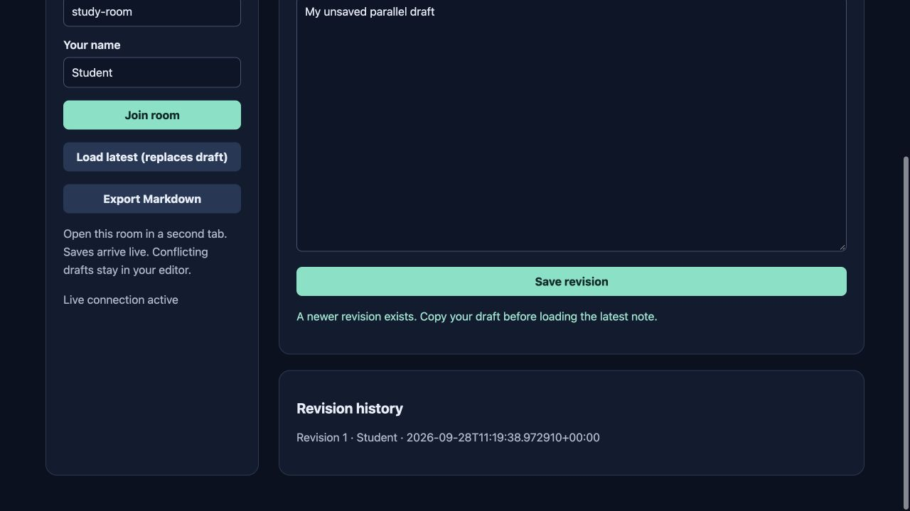

# NoteMesh

Shared meeting notes without lost edits for **study groups**.

Original topic: **Real-Time Collaborative Notes App** from [the source post](https://www.instagram.com/p/DdyMaogE4ud/).

> Personal project by Abhijith Viswanathan. Working implementation, reproducible examples and measured results are documented below.



## What works

- Live saved-note synchronization with SSE
- Optimistic revision checks and preserved conflict drafts
- Persistent revision history and Markdown export

[Example output](reports/example-output.json) · [Verification notes](VERIFICATION.md) · [Learning and interview guide](LEARNING_GUIDE.md)

## Start

Python 3.12 is the validated Python runtime. Run commands from this repository directory. Windows users activate `.venv\Scripts\activate` instead of `source`.

```sh
python3.12 -m venv .venv
source .venv/bin/activate
python -m pip install -r requirements.txt
python app.py
```

Open **http://127.0.0.1:8080**. Keep the process running. Set `PORT` to use another port. The Python development servers are intended for local demonstrations.

## Demonstration

Open study-room in two tabs. Save in one and observe the other update. Type drafts in both, save the first, then save the stale second draft and inspect the conflict message; its text is preserved.

## Architecture and decisions

Browser controls → validated Flask API → project analysis/workflow → results and export.

Stack: Flask · SQLite · SSE.

1. Optimistic integer revisions reject stale saves instead of overwriting another user's draft.
2. Server-sent events broadcast saved revisions; heartbeat frames and reconnection keep the client informed.
3. Append-only revision metadata records author and update time alongside the latest note.

## Verification

```sh
python -m pytest -q
```

See [VERIFICATION.md](VERIFICATION.md) for actual executed checks, setup verification, model/data results and any outstanding environment limitations. The [recorded CI runs](reports/ci-verification.json) passed for the linked source revision.

## Data and attribution

Local shared notes. See [DATA_AND_SOURCES.md](DATA_AND_SOURCES.md) for provenance and usage notes. Original project code is MIT unless a preserved source file or dependency states otherwise. Model and third-party data licenses remain separate.

## Limitations and next improvement

Whole-note optimistic editing, not character-level CRDT merging. No authentication or tenancy; anyone with local access to a room can edit. Author names are self-reported. History lists metadata; full historical bodies remain in SQLite.

Suggested extension: Add a read-only revision viewer using the existing history table, without changing the current note.

## Honest portfolio use

AI tools assisted with implementation, tests and documentation. This is my personal portfolio work; benchmark results and deployment boundaries are documented in the repository.

## Local performance measurements

An 8-client local HTTP workload completed **2,400 validated requests**, with **22.276 ms p95 latency**. These are synthetic local measurements, not production users or service guarantees. See the [workload, reproducible script and complete results](benchmarks/README.md).

## Connect

[LinkedIn — Abhijith Viswanathan](https://www.linkedin.com/in/abhijith-viswanathan-0a7216436/)
